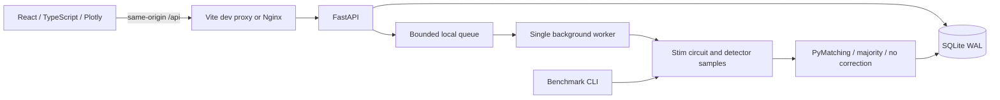

# Architecture and operations

`backend/qubitguard/models.py` validates workload and code/decoder compatibility. `engine.py` owns circuits, sampling, intervals and timing; it is independent of HTTP and storage. `store.py` uses parameterized SQLite statements and short-lived connections with WAL journaling. `api.py` schedules experiments in one thread and persists state transitions. The CLI uses the same validation and simulation path as the API.

The worker queue accepts at most four unfinished jobs (one running plus three waiting). Excess requests get HTTP 429. Sweeps are bounded to two million sampled shots and an estimated 80 million detector-shot operations. Sampling is batched to bound arrays. The limits are guardrails, not a runtime SLA. Keep **one Uvicorn process**: this local queue and restart recovery are not coordinated across processes. Do not use `--workers` or production reload while running jobs.

On startup, queued/running records are marked failed with an interruption explanation; completed history survives. This is a local, single-user application without authentication, remote job execution, cancellation or a durable distributed queue. Docker exposes only the frontend on loopback. Backup the database while the application is stopped, or use SQLite's backup API; WAL files may contain recent transactions. `docker compose down` preserves the named volume. `docker compose down -v` deletes experiment history.

## API

| Method | Path | Behavior |
|---|---|---|
| GET | `/api/health` | Engine and SQLite health |
| POST | `/api/experiments` | Validate, persist, enqueue; returns 202 + id |
| GET | `/api/experiments?limit=50&offset=0` | Newest records, paginated; dashboard shows latest 50 |
| GET | `/api/experiments/{id}` | State, progress, config and completed results |
| GET | `/api/experiments/{id}/export?format=json` | Full result and metadata download (CSV also supported) |
| GET | `/api/experiments/{id}/circuit?distance=3&physical_error_rate=0.01` | Exact Stim circuit for a configured cell |

The FastAPI interactive reference is `/docs` on the backend and `/openapi.json` contains the schema. Request validation errors return 422, missing experiments 404, and premature exports 409. Errors in a simulation are logged with the experiment ID; the client gets a concise failure message. A run completion log includes duration. Run Uvicorn with `--log-level info` to see HTTP access logs. This is basic observability rather than a metrics/tracing service.

JSON exports retain the 64-bit sampler seed as a JSON integer. Use Python to read these seeds without rounding; JavaScript numeric parsing may lose precision. The configuration's root seed is a 32-bit integer and is safe to read in JavaScript. CSV exports include per-cell seeds as text.
